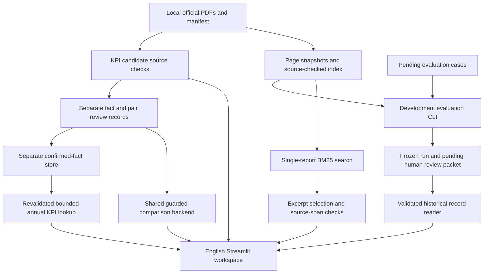

# Architecture

This is a local annual-report research prototype for AIA Group Limited's official
FY2024 and FY2025 English reports. The implemented answer path retrieves evidence
and releases original text with physical PDF-page references. A separate explicit
lookup mode reads source-checked confirmed annual KPI facts. It makes no model
API calls and does not generate summaries. Financial candidates, review decisions,
arithmetic and evaluation judgments have separate boundaries.

The [README](README.md) describes setup and the current delivery. The
[PRD](PRD.md) defines product scope and acceptance. [EVALUATION](EVALUATION.md)
records actual development runs and their limits. This document describes code
that exists; the final section identifies work that remains pending.

## Current flow

The comparison CLI currently reports pending gates for real AIA pairs. Its
arithmetic path is implemented and tested on explicitly neutral fixtures; this
does not establish approval of real report inputs. The evaluation CLI has run
against real reports, but the candidate gold answers and human response judgments
remain unapproved. The Streamlit interface now consumes source-checked review
state and guarded comparison results. Only calculated pairs can produce Plotly
charts; actual AIA pairs remain pending. About reads a validated historical Stage
8 record and explicitly distinguishes it from current runtime performance.

## Runtime and module boundaries

Python 3.11 or newer is required. `pyproject.toml` pins PyMuPDF for native PDF
extraction, Streamlit for the local interface and Plotly for guarded charts;
pytest and Ruff are development
dependencies. The implementation otherwise uses the Python standard library.
There is no embedding model, vector database, LLM SDK, database server or external
model provider in the current runtime.

| Module / entry point | Implemented responsibility |
| --- | --- |
| `pdf_parser.py` | Extract native text for every physical page; retain document metadata, source SHA256 and explicit empty/error page records; export JSON |
| `chunking.py` | Produce deterministic word windows within one page; retain exact original text and offsets separately from normalized search text |
| `indexing.py` | Re-extract registered PDFs, compare saved page snapshots with fresh output, apply the indexing policy and build the local JSON index |
| `retrieval.py` | Validate the cached index by rebuilding it; rank chunks with BM25 inside one selected document/year; return distinct evidence pages |
| `citations.py` | Resolve evidence IDs and page offsets into original excerpts; reject mixed sources, conflicting overlaps and gaps |
| `answer.py` | Select focused original excerpts from one evidence page or return an explicit abstention; enforce the current financial, comparison and advice boundaries |
| `financial_kpis.py` | Parse exact `Decimal` values; validate complete numeric tokens, rows, header context and actual PDF provenance; export pending-review CSV |
| `comparison.py` | Check structural compatibility and perform pure `Decimal` arithmetic; it does not establish owner review or source validity |
| `kpi_reviews.py` | Bind fact and comparability decisions to complete candidate digests; recheck source candidates and gate comparison results |
| `verified_store.py` | Persist explicit fact confirmations separately; bind current input bytes and revalidate saved stores, including review revocation |
| `financial_answer.py` | Recognize bounded single-metric annual lookup forms and release only a source-revalidated, scope-matching confirmed fact |
| `session_data.py` | Prepare a complete isolated session runtime from exactly two pinned PDF uploads, using staged parser/index/source checks and public metadata snapshots |
| `evaluation.py` | Validate source-backed development drafts, run cases, record errors/latencies, check released spans and export pending human judgments |
| `evaluation_records.py` | Validate historical run bindings/aggregates and current data dependencies; flag older code/configuration without inventing live scores |
| `ui_charts.py` | Plot two reported annual levels from a calculated guarded result, preserving exact labels, percent units and source metadata |
| `ui_state.py` | Validate the fixed AIA inventory, fingerprint current source bytes, form official PDF page links and read an optional historical engineering record |
| `ui.py` / `app.py` | Render scope controls, excerpt cards, candidate review and explicit unavailable states using per-session state |
| `scripts/check_kpi_candidates.py` | Check actual candidate PDF spans and export a pending review sheet |
| `scripts/check_comparison_readiness.py` | Prepare all-pending review packets or audit guarded comparison readiness against current sources |
| `scripts/build_verified_store.py` | Export a new local reviewed-fact JSON store or validate an existing one without modification |
| `scripts/ask_reviewed_kpi.py` | Run the reviewed KPI lookup without a retrieval index; preserve response JSON and protect input paths |
| `scripts/run_evaluation.py` | Load source-checked cases/index, freeze dependency fingerprints, preserve a raw run and create its pending human review packet |
| `scripts/run_retrieval_smoke.py`, `scripts/run_extractive_smoke.py` | Preserve earlier engineering probes separately from the later development evaluation |

The parser, index, retrieval and answer modules also expose command-line entry
points. `fic-parse-pdf` is registered by the package. Commands and ordering are in
the README and phase reports; output-producing commands refuse existing output
names rather than silently replace an earlier record.

## Data and local persistence

Small source registries, policies and review proposals use CSV or JSON. An index
is a reproducible cache, not an authoritative financial store.

| Location | Content and treatment |
| --- | --- |
| `data/manifest.csv` | Registered document IDs, issuer/year, exact acquisition URLs/timestamps, local filenames and actual PDF hashes |
| `data/raw/` | Local official PDFs; Git-ignored except `.gitkeep` |
| `data/processed/*.pages.json` | Full page text, physical page sequence and extraction statuses; Git-ignored |
| `data/processed/retrieval-index.json` | Full evidence chunks plus indexing policy/source metadata; Git-ignored |
| `data/retrieval_policy.json` | Chunk settings and explicit page exclusions with reasons; excluded pages remain in the original page inventory |
| `data/retrieval_cases.json` | Earlier engineering retrieval probes; not an approved acceptance benchmark |
| `data/kpi_candidates.json` | Ten unverified AIA metric candidates, short source context, exact offsets and financial-basis caveats |
| `data/kpi_reviews.json` | Separate fact and annual-pair decisions, currently pending; not a verified financial database |
| `data/processed/verified-kpis*.json` | Optional reviewed-fact projections; source/review-bound, Git-ignored, currently empty for real data |
| `data/evaluation_cases.json` | Forty development-exposed question/answer/evidence proposals, all pending owner review |
| `data/processed/` evaluation/readiness outputs | Raw responses, diagnostic hits, errors, timings, source checks and pending human review packets; Git-ignored |
| `.env.example` | Reserved configuration names for later work; no current model integration reads an API key |
| `.env`, `.streamlit/secrets.toml` | Ignored secret locations; actual credentials must not enter source control |

Raw PDFs, complete extracted text and local run/cache artifacts are not
redistributed. A fresh checkout must obtain its own authorized official reports
and reproduce local parsing/indexing. The repository retains source metadata and
necessary short evidence proposals; public accessibility does not itself grant
permission to republish full reports. No source-licensing conclusion is derived
from a successful hash or extraction check.

## Page and evidence identity

`pdf_page` is the physical position in the PDF, starting at 1. Covers, printed
page labels, Roman numerals and empty pages do not alter that numbering. Extraction
failure and empty native text produce explicit records rather than shifting later
pages. OCR is not implemented.

Each chunk carries document ID, issuer, report year, language, physical page,
source PDF SHA256, official URL, original text and a half-open character range
`[char_start, char_end)`. Offsets refer to Python string positions in that page's
native extracted text, not PDF byte positions or screen coordinates. The stable
chunk ID binds the chunking version, PDF hash, document/page, offsets and text.

The offset coordinate space belongs to the artifact that supplies it. Retrieval
chunks/excerpts use the parser's page `text`, which trims outer whitespace;
financial candidates and proposed evaluation evidence use fresh sorted native
page text without that trimming. Their offsets must not be interchanged. Source
checks reconstruct each span using its own extraction path and retain the same
PDF hash and physical page.

Search normalization handles whitespace, Unicode normalization, replacement
characters and dot leaders only in `search_text`. It does not rewrite
`raw_text`. A released quote is reconstructed from named evidence IDs and offsets,
not trusted because an answer supplied matching text. Multiple supporting chunks
must identify the same page/source and cover a continuous range with agreeing
overlaps. Unknown IDs, gaps and conflicting source identity fail validation.

Source cards show `PDF page N` and link to the registered official URL with
`#page=N`. The app does not host the original PDFs. Issuer/year/language metadata
and the official-source decision still need source review; a filename, URL year
directory or valid HTTPS syntax cannot establish those facts.

## Index loading and question scope

`build_index` compares freshly extracted PDFs with the manifest and saved page
snapshots, including page count, sequence, metadata, statuses and text. It applies
the current policy, retaining reasons for pages that are excluded or not
indexable. A stored hash field beside edited text is insufficient.

`load_retriever` rebuilds this deterministic index in memory and compares its
canonical JSON with the saved cache before returning a retriever. Changed PDF
bytes, page text, policy or cached chunks are rejected. This deliberately costs
startup time for the small two-report corpus. The loaded object can then serve
multiple in-memory queries without rebuilding for each search.

BM25 filters by document ID and report year before calculating corpus statistics
and ranking. At most one best chunk is returned for each physical page, so
`top_k=5` means up to five distinct pages. No lexical match returns no evidence;
positive scores are ranking values rather than calibrated confidence. Explicit
references to a different annual-report year are rejected by scope rules;
historical fiscal-year mentions inside the selected report are allowed. This is
a heuristic report-scope policy, not comprehensive language understanding.

Question answering uses one selected report. The KPI tab's **Both fiscal years**
option explicitly displays separate candidate records for review; it does not
enable mixed-year question answering or certify comparable financial inputs.

## Local excerpt responses and UI state

The selected mode releases up to three focused quotes from one evidence page.
It can include validated same-page context, but it does not compose a summary,
combine several pages into a synthesized answer or establish completeness.
Lexical relevance/coverage checks and intent rules determine when the prototype
abstains. Recognized financial-metric, comparison, unsupported-evidence,
citation-override, prediction and investment-advice requests have explicit
boundaries. These rules are not a complete adversarial or semantic classifier.

The English Streamlit workspace has four tabs: Ask the Annual Report, Financial
KPIs, Year-over-Year, and About & Evaluation. Source text is rendered as literal
code text rather than executable HTML. Response JSON and the pending candidate
CSV can be downloaded. Financial KPIs also projects recorded fact confirmations
without changing the candidate records. Year-over-Year displays pair readiness,
reasons and both sources; only a calculated result enters the chart/metric path.
Its audit JSON retains exact Decimal results and review records. About reads the
optional frozen Stage 8 development run, checks content bindings and aggregates,
and requires the recorded data dependencies to match actual current bytes.
Code/configuration differences are shown as historical context. Human scores
remain unavailable; the counts are not presented as live accuracy.

Ask has separate **Original excerpts** (default) and **Reviewed KPI lookup**
modes. The latter uses a full-query grammar and the current canonical local
store. It releases only a matching annual metric after source/review checks,
with exact decimal strings, period/scope/basis and explicit numeric-token and
review labels. It does not synthesize an explanation or turn an annual group
level into a regional, interim, currency-adjusted or comparable value. The
original excerpt engine and historical evaluation remain a separate mode.

The validated retriever and KPI candidates are cached in the individual
Streamlit session. There is no shared global mutable engine cache. Each rerun
hashes actual bytes of the manifest, policy, index, both raw PDFs, page snapshots
and optional candidate/review/store files, evaluation suite/record and project config.
A workspace revision, answer-mode or fiscal-year change
clears old responses and cached objects. The answer path also checks the
fingerprint after loading and after answering; **Recheck local sources** forces
fresh validation. Missing or inconsistent sources display errors rather than
release a previous response.

Retained lookup responses are revalidated through `answer_reviewed_kpi` on each
rerun before display; a saved verified flag is insufficient. An absent store
produces an unavailable abstention, an unconfirmed metric produces no value,
and a stale/malformed store produces an error. The current UI still requires
the normal report/page/index inventory even though lookup does not call the
retriever. The lookup CLI does not require an index.

These checks run on rerun/query/recheck, not continuously while a browser page
sits idle. The UI fingerprint does not cover every file in the repository. Review
state/results have the same revision boundary and a fresh pre-display check;
validation failure clears them. Historical evaluation records are read without
reusing a prior valid projection on error. CLI workflows retain their own source
checks. Source-byte hashing and rebuilds also make first-use verification slower
than subsequent same-scope questions.

`.streamlit/config.toml` binds the local server to `127.0.0.1`, disables static
file serving and usage statistics, and configures the English workspace theme.
These settings retain the local preview defaults. The hosted session-data
workflow is described below.

For the existing Community Cloud deployment, the UI can accept exactly the two
registered official PDF versions into separate 16 MiB upload controls. The
server validates complete-byte hashes before parsing; it never treats uploaded
content as instructions or retrieves reports automatically. A private
`TemporaryDirectory` owns each session's runtime. `session_data.py` copies only
allowlisted public metadata, builds raw/page/index files in staging, revalidates
the index and recorded fact projection, then atomically renames the completed
tree before UI adoption. It never populates the source checkout or copies
secrets, an existing full-text cache or historical evaluation raw runs.

Session adoption checks the source metadata fingerprint again. A later metadata
or review change discards the old session workspace. Clearing loaded reports
removes the session-owned temporary runtime and resets its upload controls;
other sessions and the prepared local source workspace are separate. An idle
disconnect does not establish instantaneous deletion or durable retention.
This supports user-supplied authorized processing, not a preloaded public corpus
or a source-rights conclusion. See [cloud setup](docs/cloud-setup.md).

## Financial facts, reviews and arithmetic

Candidates remain distinct from reviewed decisions. `financial_kpis.py` only
accepts unverified, pending candidate records. It checks actual raw PDF hashes,
fresh page text, exact numeric/row/header spans, complete numeric-token
boundaries, supported currency/unit pairs, periods and reference metadata. It
parses numbers into `Decimal` without guessing missing values or changing units.
Percent values remain percent units rather than decimal fractions.

These checks prove that a candidate points to its stated source token. They do
not identify the right financial column, define NCI treatment, settle tax or FX
basis, or make two years comparable. Owner review must resolve those questions.
The [KPI review guide](docs/kpi-review-guide.md) explains the actual AIA caveats.

`kpi_reviews.py` binds each fact decision to the canonical digest of the complete
raw candidate record, including its value, source context, scope, period,
definitions and caveats. Pair decisions bind both candidate IDs and digests.
Changed candidate content invalidates the corresponding review. Pending decisions
cannot contain approving checks or reviewer signatures; decided records require
reviewer, timezone-aware time and explanatory notes. The packet must contain the
expected candidates and annual pairs exactly once.

Fact confirmation and comparability approval are separate. Fact checks cover
value, currency/unit, period, scope, definition and source. Pair checks cover
definition, currency/unit, period, scope, exchange-rate basis, tax basis and
restatement. Both facts must be confirmed and the pair explicitly comparable
before `comparison_results` releases arithmetic. A matching prior-year cell or
equal scope/basis text cannot replace that decision. There is no UI approval
button. The Stage 11 store exporter projects only already-recorded confirmations;
it cannot create a decision or infer approval from a source match.

`verified_store.py` stores only confirmed facts with their original context,
decimal strings and complete fact-review metadata. It fingerprints candidate,
review and manifest bytes plus referenced source PDFs before and after checking
sources. Loading recomputes the expected projection from current inputs and
compares canonical JSON, preserving type distinctions such as booleans versus
integers. Revoked, deleted or changed decisions and altered stores fail closed.
Exports refuse an existing filename. Candidate records remain unverified and
unchanged; fact confirmation does not promote pair comparability. These are
operator-recorded decisions, not authenticated reviewer identities. Consumers
must use the loader rather than trust a saved `verified` field. The financial
tabs and comparisons still read live reviews. The separate Stage 12 lookup mode
uses this store; its full-query grammar refuses unsupported qualifications,
multi-metric queries, mismatched years/companies and incompatible units. An
annual lookup also requires a complete January-to-December source period.

The pure functions in `comparison.py` have a narrower contract: they validate
structural compatibility and calculate exact finite `Decimal` differences.
Structural checks require the same issuer/metric/currency/unit/scope/basis,
separate source documents, consecutive years and full January-to-December annual
periods. Leap years do not require identical day counts. A nonpositive prior
value refuses a routine calculation. Monetary amounts produce absolute and
percentage change; percent-unit inputs produce a percentage-point difference.
The pure arithmetic helper alone does not authorize real financial output.
Callers must use a source-checked review state from the same operation.

The real review packet is still pending. No verified KPI CSV/database or real
YoY chart has been created. Generic requests to continue development do not
confirm financial facts. Review hashes bind content; they are not authenticated
human signatures. Recording an actual owner decision remains an operator
responsibility.

## Evaluation and human judgment

`load_suite` accepts development drafts with pending owner review, no approved
gold and explicit proposed answerability/current-mode behavior. It checks each
proposed quote against the registered PDF hash, fresh native text and exact
document/year/page/offsets. The suite contains simple facts, financial numbers,
table/basis questions, cross-year questions and boundary cases. These questions
are development-exposed, not held out.

`run_cases` preserves every case row, including diagnostic retrieval errors,
answer exceptions, status/reason mismatches, released quotes and source-span
errors. Proposed page hits compare document, fiscal year and physical page;
cross-report or evidence-free cases are excluded from that specific denominator.
An expected scope rejection is distinguished from an unexpected diagnostic
failure. Zero released spans means not applicable rather than successful
citation verification. Per-case timings include an additional diagnostic search;
they are not ordinary UI latency.

The run stores a frozen suite snapshot and digest, case/response digests, runtime
versions, actual latencies and raw outputs. The CLI hashes source PDFs, saved
pages, manifest, policy, index, optional configuration/review inputs and Python
source files before and after execution. Changing dependencies prevent
publication of that run. Existing output names are preserved.

`make_review_packet` checks the frozen run/suite/case/response binding and exact
case membership, then exports pending gold review and response-rating fields.
The four semantic judgments - answer correctness, citation relevance, numerical
correctness and abstention correctness - remain null until actual human review.
Behavior matches, source-span checks and draft page hits are reported separately;
none is relabeled as financial or semantic accuracy. See
[EVALUATION](EVALUATION.md) and the
[evaluation review guide](docs/evaluation-review-guide.md) for actual counts,
observed failures, exposure and review instructions.

Dependency fingerprints show which bytes a run used and detect changes across
the measured operation. They do not authenticate reviewer identity, establish
source rights or prove semantic correctness. They are also not a guarantee that
the filesystem cannot change after a run is saved.

## Current limits and future gates

The prototype supports these two English reports and native PDF text. Table
reading order, sidebar noise, replacement characters, incomplete multi-part
answers and lexical paraphrase limits remain documented risks. No broad OCR,
arbitrary-document upload, production authorization, external financial-data
feed or trading integration exists.

The remaining gates are explicit:

1. Owner-confirmed financial facts and separate comparability decisions. A
   distinct reviewed-store exporter/validator is implemented; populated real
   inputs and actual numerical-answer acceptance remain pending. The bounded
   reviewed-fact lookup path is implemented, with neutral positive-path tests.
2. Exercise the integrated comparison/chart path on actual data after explicit
   approval; the current positive-path demonstrations use neutral fixtures only.
3. Owner-approved evaluation gold and human scoring of frozen responses, followed
   by honest semantic metrics and new independent acceptance cases where needed.
4. Generative answering, embeddings or reranking only as a separately configured
   extension with approved cost/data handling, evidence constraints and semantic
   evaluation. No such model integration is implied by the current excerpt mode.
5. Finished, validated source increments are published to the existing public
   GitHub repository under the owner's standing authorization. Raw reports and
   full text remain local; deployment and paid APIs require separate approval.
   The published artifact is still a local portfolio prototype.

Implemented comparison presentation and historical evaluation inspection do not
complete those business acceptance gates. The current data still has zero
confirmed facts, zero approved pairs and no human-scored semantic metrics.
