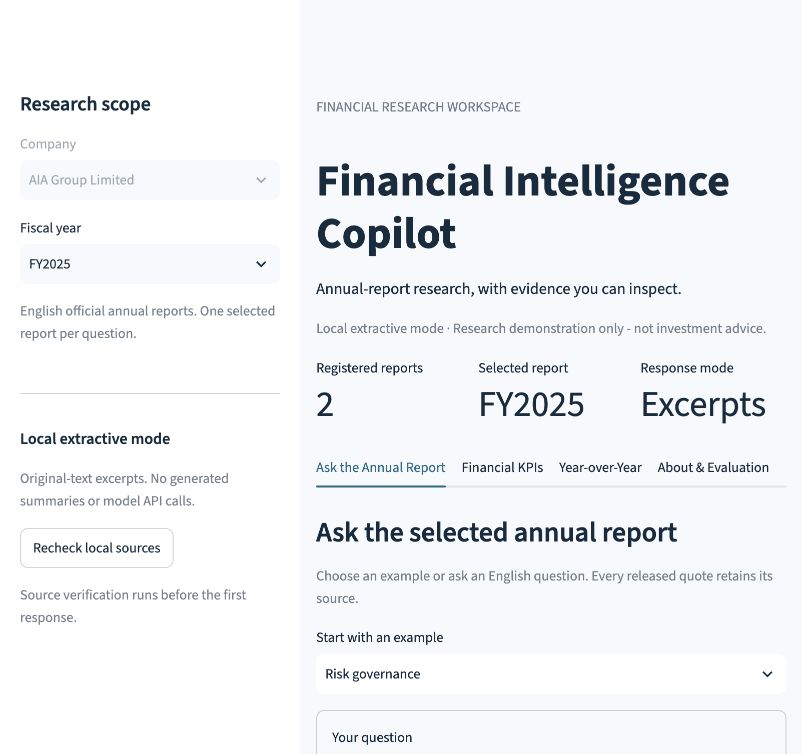
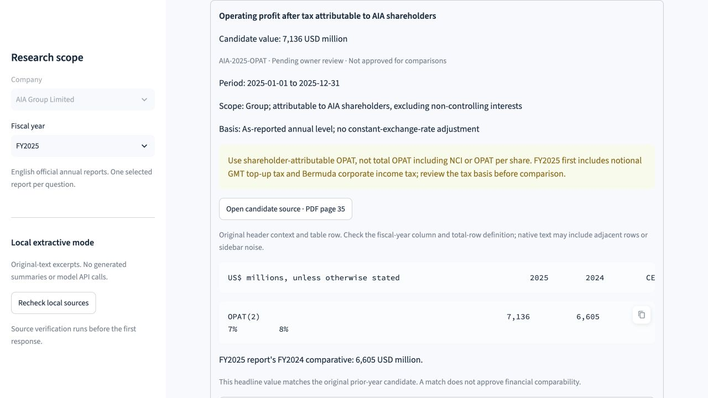
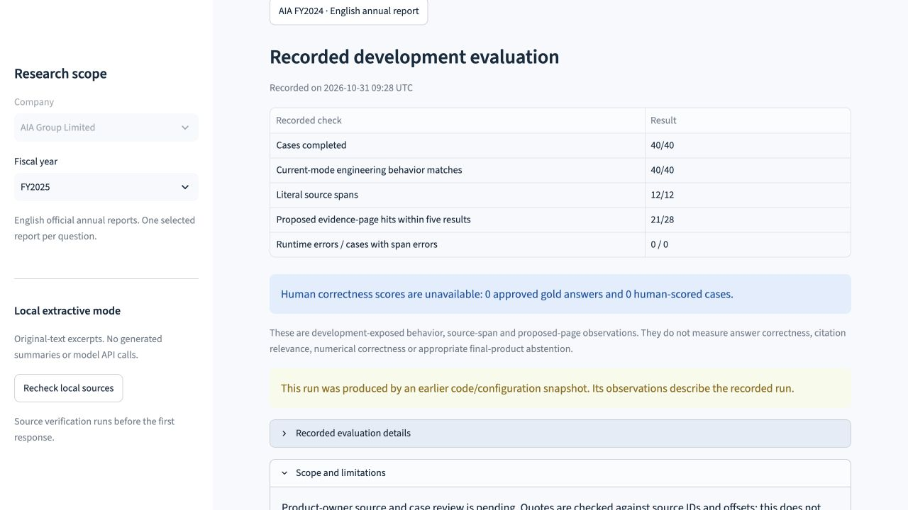
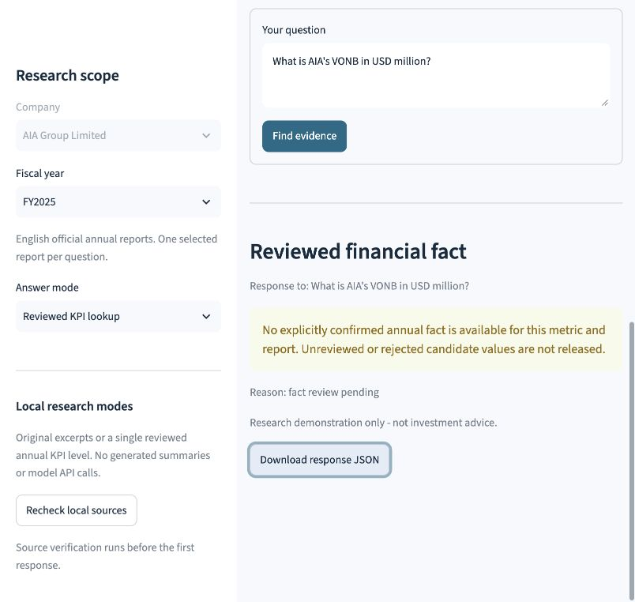

# Financial Intelligence Copilot

A financial research portfolio project for analysts and FinTech product teams.
The planned MVP uses **AIA Group Limited's official FY2024 and FY2025 English
annual reports** for evidence-grounded Q&A, verified financial KPIs, comparable
year-over-year analysis, and a documented evaluation.

**Research demonstration only - not investment advice.**

English is the default for code, UI, documentation, tests, evaluation reports,
and demonstration materials. Other languages are used only when necessary, such
as preserving original source evidence or meeting an explicit requirement.
See `AGENTS.md` for the project language policy.

## Current implementation: automatic official-report loading

The product owner selected a public link that works without visitor uploads.
On a clean checkout, `app.py` automatically downloads the two registered AIA
reports from their exact official HTTPS URLs, verifies pinned SHA256 hashes,
and builds a complete temporary server workspace. New tabs and refreshed pages
reuse that checked runtime. A server restart downloads and prepares it again.
See [cloud initialization and troubleshooting](docs/cloud-setup.md).

Raw reports, page text and indexes remain outside Git. The app offers no full
report/text download and calls no model API. Existing local data takes precedence;
partial or damaged local datasets are not silently replaced. If official fetching
fails, an explicit retry and the isolated two-report upload fallback remain
available. Uploads are never promoted into the shared automatic cache.

The original source/review metadata stays unchanged. Automatic loading enables
original-excerpt research; it does not approve financial facts, comparisons or
human evaluation judgments. The actual financial review gates remain pending.

Automatic initialization passed **657 automated tests**, lint/format checks and
dependency consistency checks. An actual-network local rehearsal downloaded both
pinned official versions and preserved the same evidence and pending financial
state. Hosted refresh/new-tab acceptance is recorded separately in the
[Stage 14 report](docs/phase-14-report.md).

The earlier session-only cloud repair passed **609 automated tests** (5 existing dependency
deprecation warnings), Ruff check/format and dependency consistency checks.
A clean isolated rehearsal with the actual reports rebuilt 734 physical pages
and 2,159 chunks, returned FY2025 page 64 evidence, and kept financial facts
pending. See the [repair record](docs/phase-13-report.md).

The hosted follow-up on 2026-11-08 also completed the actual browser upload of
both reports. The cloud app reported 734 physical pages / 2,159 chunks, returned
the FY2025 page 64 source card, and refused an unconfirmed VONB lookup. Actual
downloaded response JSON was retained locally; this is an engineering check,
not financial approval or a new semantic evaluation.

Read the [product requirements](PRD.md), [implemented architecture](ARCHITECTURE.md),
[actual evaluation](EVALUATION.md), [English demonstration script](docs/demo-script.md)
and [owner acceptance worksheet](docs/acceptance-checklist.md). The documentation
describes the current prototype and the remaining acceptance gates; it does not
declare the full MVP complete.

The local Streamlit workspace now supports company/year selection, English
questions, original-text source cards, physical PDF page links, explicit
abstentions, response JSON export, and recorded development-check information.
The Financial KPIs tab now offers ten source-backed **unverified candidates**
covering five metrics in both years, with exact source context, financial-basis
notes, and CSV export. Verified KPIs and Year-over-Year calculations remain
pending product-owner review. No candidate is automatically approved.

Year-over-Year now reads the source-bound fact/pair reviews, displays each pair's
readiness and both annual source links, and renders Decimal results/Plotly charts
only when every gate passes. Financial KPIs separately shows recorded fact
confirmations. The current real-data audit still has **0 confirmed facts and
0/5 pairs calculated**; no actual AIA growth figure or chart has been produced.
The conditional chart path is tested with explicitly neutral fixtures.

Stage 11 adds a separate local JSON store containing only explicitly confirmed
KPI facts. Its export/check commands revalidate current source PDFs, candidates
and review decisions; stale or altered stores are rejected. The actual pending
AIA packet exports **0 reviewed facts**. Fact confirmation does not approve a
comparison. The financial tabs and comparison backend continue to validate live
reviews. Stage 12 adds an explicit **Reviewed KPI lookup** mode to Ask the Annual
Report, alongside the default **Original excerpts**. It revalidates the store on
each lookup and returns only a matching confirmed annual fact, with its exact
decimal value, source page and review context. Current AIA queries still abstain;
no real numerical answer has been approved or released.

Stage 11 passed **490 automated tests** (5 dependency deprecation warnings),
Ruff check/format and dependency consistency checks. The new backend/CLI tests
use explicit nonfinancial fixtures. Real-source export/check retained 0/10
confirmed facts and 0/5 calculated pairs. See the
[actual Stage 11 record](docs/phase-11-report.md).

The new lookup deliberately supports one metric's reported annual level. It
rejects definition/basis interpretation, regional/interim data, conversions,
derived ratios, multiple metrics and comparisons. It does not infer what an
unsupported question meant. VONB margin stays a percent metric, separate from
after-NCI VONB and ANP; the lookup never recomputes it.

Stage 12 passed **575 automated tests** (5 existing dependency deprecation
warnings), Ruff check/format and dependency consistency checks. Five actual
metric lookups and five boundary queries released no unreviewed financial
values. The historical forty-case evaluation was not rerun or relabeled as
current lookup accuracy. See the [Stage 12 record](docs/phase-12-report.md).

A 40-case development suite and evaluation runner are now available. The actual
after-fix run completed 40/40 cases, matched 40/40 current-mode engineering
expectations and preserved 12/12 released source spans. Proposed evidence-page
hits at rank 5 were 21/28. There are **0 approved gold answers and 0 human-scored
cases**; no answer, numerical or citation-relevance accuracy is claimed. See
[actual evaluation results and limitations](EVALUATION.md).







The first two captures are recorded Stages 5/6 views. The last is the Stage 10
interface reading the historical Stage 8 evaluation. Candidate values remain
pending owner verification; historical behavior/page counts are not live accuracy.



The Stage 12 capture shows the genuine pending state: the new mode releases no
unreviewed AIA financial value.

### First run in a new checkout

On the hosted app, wait for automatic official-report initialization and the
**Official reports ready** message. No browser upload permission is needed.
For a local source checkout, follow the steps below. Running `app.py` without
local runtime files also enables automatic loading; set the process environment
variable `FIC_AUTO_LOAD_REPORTS=false` to use only local data or manual uploads.

1. [Install the environment](#install-the-environment) and run the tests. Neutral
   test fixtures do not require the official reports.
2. [Obtain and register both reports](#obtain-the-two-official-reports-manually).
   Raw PDFs, saved page text and indexes are deliberately absent from a checkout.
3. [Parse each report](#parse-a-local-report), then
   [build the evidence index](#build-and-query-the-local-evidence-index).
4. Open the workspace with the command below. To reproduce development results,
   [run the evaluation](#run-the-development-evaluation) using new output names.

Run commands from the project root. A manifest row or candidate dataset alone
does not establish that the required local source files are present.

### Open the local workspace

With the environment installed, run from the project root:

```bash
.venv/bin/python -m streamlit run app.py \
  --server.address 127.0.0.1 --server.port 8501 \
  --server.headless true --browser.gatherUsageStats false
```

Open [the local workspace](http://127.0.0.1:8501). If the preview is already
running, use that address rather than starting a second copy. Stop a manually
started preview with Ctrl+C in its terminal. This is a local preview, not a
public deployment.

Choose FY2024 or FY2025, select an example or enter a question, then click
**Find evidence**. The first response verifies local source files and may take
several seconds. Subsequent same-scope questions reuse the validated in-memory
snapshot. Changing years or local source bytes clears the previous response.
**Recheck local sources** forces a fresh verification. Use the official PDF links
to inspect context; the app does not host the original PDFs.

See [the KPI review guide](docs/kpi-review-guide.md) for candidate IDs, physical
pages, values and the scope/tax issues requiring a decision. In **Financial
KPIs**, use **Review candidate** and its official source link; **Both fiscal
years** is an explicit review view, not a calculated comparison. Downloading the
review CSV preserves `verified=false` and the pending status.

Stage 10 commands, tests and live-browser observations are in
`docs/phase-10-report.md`: 446 tests passed, Ruff check/format passed and
`pip check` found no broken requirements. About & Evaluation validates the recorded Stage 8 run
and displays its original date, denominators and null human scores. A newer code
or configuration snapshot is labeled historical. A changed/missing source or
invalid record produces an error rather than reusing old counts. Software checks
are separate from answer accuracy and owner acceptance.

Implemented: local PDF page extraction, one-based physical page numbers,
caller-supplied issuer/year metadata, file SHA256, explicit empty/error page
records, JSON export, and parser unit tests.

Also implemented: source-checked local indexing, deterministic page-bounded
chunks, document/year-filtered BM25 search, original-text evidence cards, and an
eight-case engineering retrieval smoke run. No additional dependency or API key
is required.

The product owner selected **local verbatim-excerpt responses**. The answer module
now selects up to three focused excerpts from one source page or returns an
explicit abstention. Every quote is reconstructed from source IDs and exact page
offsets, including explicitly named same-page context expansion. It does not call
an LLM, summarize, or establish answer completeness.

Both official reports were downloaded and parsed locally on 2026-10-25. All 734
page records passed hash, metadata, and physical-page sequence checks. Covers,
selected body pages, and statement pages received engineering visual spot checks;
product-owner review remains pending.

| Report | Physical PDF pages | Pages with native text | Empty-text pages | Extraction failures |
| --- | ---: | ---: | ---: | ---: |
| AIA FY2024 | 371 | 371 | 0 | 0 |
| AIA FY2025 | 363 | 362 | 1 | 0 |

FY2025 PDF page 3 is promotional artwork without native extractable text. Four
FY2025 contents pages contain replacement characters. A reviewed indexing policy
excludes these navigation pages while keeping all original page records. See
`docs/phase-2-report.md` for the ingestion findings.

The local index contains 2,159 chunks: 1,088 for FY2024 and 1,071 for FY2025.
The eight engineering probes hit an expected page at rank 1 in 7/8 cases and
within five distinct result pages in 8/8 cases. These cases await product-owner
review and measure page retrieval only. They are not answer accuracy, citation
accuracy, or the planned 40-question evaluation. See `docs/phase-3-report.md`.

The Stage 4 real-data development probes produced ten source-consistent excerpts
for eight questions. Twelve explicit refusal probes matched expected behavior;
106 unit tests passed. These are engineering checks, not answer accuracy or a
general refusal-rate measurement. Two multi-part questions still have partial
evidence coverage. See `docs/phase-4-report.md` for limitations and raw-run paths.

Pending: generative answering, semantic claim validation, embeddings, verified
KPIs, real reviewed comparisons/charts, and owner-reviewed semantic evaluation. No verified KPI
dataset or LLM-evaluation scores have been produced. Unit fixtures remain neutral
documents; real-data development probes are recorded separately.

## Local setup

### Install the environment

Use Python 3.11 or newer in an isolated virtual environment. The initial local
verification uses Python 3.13.9. PyMuPDF, Streamlit, Plotly, pytest, and Ruff are pinned in
`pyproject.toml`, the single dependency manifest for this stage. The pinned build
backend is installed by pip's normal isolated build process.

```bash
cd financial-intelligence-copilot
# Use your installed Python 3.11+ interpreter.
python3 -m venv .venv
source .venv/bin/activate
python -m pip install -e '.[dev]'
python -m pytest -q
python -m ruff check .
python -m ruff format --check .
```

If needed, replace `python3` with your Python 3.11+ interpreter and `cd` into
your checkout. Installation normally needs access to a
Python package registry. No API key, model download, or paid API is required.
`.env.example` reserves settings for later stages; the current local workflows
do not read model credentials. Do not install the unrelated package named `fitz`.

### Check the KPI review dataset

After obtaining the registered local PDFs, run from the project root:

```bash
.venv/bin/python scripts/check_kpi_candidates.py \
  --output data/processed/kpi-source-check.rerun.json \
  --csv data/processed/kpi-candidates.rerun.csv
```

Choose new output filenames if they already exist. The check reads the actual
PDF bytes and exact page spans; the CSV is a review sheet, not a verified store.
It does not compute growth or approve financial definitions. Current engineering
checks found ten matching candidate tokens and five matching prior-year
comparative values; zero records are verified. Missing local reports fail closed.

### Audit comparison readiness

Audit the source-bound fact and comparability reviews with:

```bash
.venv/bin/python scripts/check_comparison_readiness.py \
  --output data/processed/comparison-readiness.rerun.json
```

Use a new filename for each run. `data/kpi_reviews.json` currently contains ten
pending fact decisions and five pending pair decisions with no reviewer
signatures. Missing decisions remain pending; malformed or stale decisions fail
closed. The [review guide](docs/kpi-review-guide.md) explains how actual owner
decisions can be recorded. The command never writes a verified store.

### Export and recheck reviewed KPI facts

After obtaining the registered local PDFs, create a separate local store:

```bash
.venv/bin/python scripts/build_verified_store.py \
  --output data/processed/verified-kpis.rerun.json
.venv/bin/python scripts/build_verified_store.py \
  --check data/processed/verified-kpis.rerun.json
```

Choose a new output filename for each export. Missing local sources fail before
output is written. A successful command with the current real packet produces
an empty `records` list: all ten facts are still pending. It is a valid empty
review projection, not a verified financial dataset or financial acceptance.

Each confirmed record retains exact decimal strings, report identity, physical
page/offsets, definitions and caveats, and the actual recorded reviewer, time,
notes and checks. Candidate and review files are not edited. The separate store
binds their bytes, the manifest and referenced PDFs. Review revocation/removal,
source edits and payload tampering invalidate old stores. Reading JSON directly
does not validate it; use `load_verified_store` or `--check` against current local
inputs before use. Files stay under ignored `data/processed/`.

Review metadata records an operator-entered decision; content hashes do not
authenticate a human reviewer. A confirmed fact retains pending comparability,
and the existing separate pair/structural gates still govern calculations.

### Look up a reviewed annual KPI

The UI lookup uses `data/processed/verified-kpis.json`. Export that local file
once, using a fresh path if an earlier export exists:

```bash
.venv/bin/python scripts/build_verified_store.py \
  --output data/processed/verified-kpis.json
.venv/bin/python scripts/ask_reviewed_kpi.py \
  --doc-id AIA-2025-EN --fiscal-year 2025 \
  --query "What is AIA's VONB in USD million?"
```

With the real all-pending review packet, the second command returns `abstained`
with `fact_review_pending` and no financial fact. A missing store returns
`verified_store_unavailable`; stale/invalid stores and source failures are errors,
not a reason to trust a previously saved value. Exporting does not approve facts.
After an actual review decision changes, create a fresh store under a new name
and validate it. The CLI accepts `--store` (relative paths use `--root`) and an
optional new `--output` response path. The UI reads only the canonical filename;
deliberately adopt a current export there after preserving an earlier local
record. The app never rewrites review decisions or stores.

In the sidebar choose **Reviewed KPI lookup**, select the report year, and ask
one of these bounded forms: `VONB`, `Show ANP for FY2025`,
`What is AIA's VONB in USD million?`, or `Show VONB_MARGIN in percent`.
Supported metrics are VONB, ANP, VONB_MARGIN, OPAT and UFSG, with the explicit
English aliases listed in `financial_answer.py`. No general financial question
understanding is claimed. Queries for another year/company, unknown qualifiers
or incompatible units do not release a value. A successful response labels an
annual reported level and shows its period, scope, basis, source numeric token,
row/header context and actual recorded fact review. A numeric token is not a
sentence-level quote or a comparability decision.

Mode/year/source/store changes clear previous UI responses. Retained reviewed
answers are revalidated before display on each rerun. These checks occur when
the app reruns, not continuously in an idle browser. The UI still requires the
normal local report/page/index inventory to be present; the standalone lookup
CLI needs the local source/candidate/review/store inputs but no retrieval index.

## Obtain the two official reports manually

1. Open [AIA's official Annual Reports page](https://www.aia.com/en/media-centre/annual-reports).
2. Select the **2024** and **2025** full English annual reports. Open each PDF and
   check the cover year and company name (**AIA Group Limited**). Do not substitute
   an interim report, results presentation, or highlights summary.
3. Use your browser's download action. Save the files under these local paths:

   ```text
   data/raw/AIA_2024_Annual_Report_EN.pdf
   data/raw/AIA_2025_Annual_Report_EN.pdf
   ```

   The official links rechecked through the AIA page on 2026-10-25 are:

   - [AIA Annual Report 2024 (English)](https://www.aia.com/content/dam/group-wise/en/docs/investor-relations/2025/2024%20Annual%20Report%20%28Eng%29.pdf)
   - [AIA Annual Report 2025 (English)](https://www.aia.com/content/dam/group-wise/en/docs/investor-relations/2025/AIA%202025%20annual%20report_EN.pdf)

   The 2024 PDF also lives in a URL directory named `2025`. Determine the fiscal
   year from the report, not the URL directory or the year you download it.
   If a link changes, return to the official page. If access fails, record the
   issue and obtain the report manually from an authorized official source.
4. Record the actual download date/time and exact final official PDF URL. Compute
   the hash of the downloaded bytes on macOS:

   ```bash
   shasum -a 256 data/raw/AIA_2024_Annual_Report_EN.pdf
   shasum -a 256 data/raw/AIA_2025_Annual_Report_EN.pdf
   ```

5. Record each actual local report in `data/manifest.csv` using the rules below.
   The inventory now records the two files from this development run. On another
   machine, verify your own files and record their actual acquisition details;
   inventory rows alone do not establish that local PDFs are present or valid.
6. Run the parser commands below and review the page output before proceeding to
   retrieval. Local parsing and source verification remain necessary even though
   the official links have been checked.

The two reports are present in this development workspace, but raw PDFs and
extracted full text are ignored by Git and are not distributed with the project.
Other checkouts must obtain their own authorized copies. A public download link
is not a redistribution license; review source terms before any public release.

## Source manifest

`data/manifest.csv` has these fields:

| Field | Fill only from the actual source/file |
| --- | --- |
| `doc_id` | `AIA-2024-EN` or `AIA-2025-EN`, unique per report |
| `issuer`, `ticker` | Confirm `AIA Group Limited` and `1299.HK` against the source |
| `fiscal_year`, `period_end` | Verify the report year and period end; use ISO date for period end |
| `language` | `en` after checking the downloaded document |
| `source_url` | Exact official PDF URL used for the download |
| `date_downloaded` | Actual ISO 8601 download timestamp, including timezone |
| `sha256` | Full 64-character hash of the downloaded file |
| `local_filename` | Path relative to `data/raw/`, matching the actual saved filename |
| `notes` | Source checks, version differences, or access/parse limitations |

The parser computes a local hash but does not populate the manifest or verify
issuer, language, or year automatically. Cross-check its hash against the manifest.

## Parse a local report

With the environment active, run from the project root:

```bash
fic-parse-pdf data/raw/AIA_2024_Annual_Report_EN.pdf \
  --doc-id AIA-2024-EN --issuer 'AIA Group Limited' --fiscal-year 2024 \
  --output data/processed/AIA-2024-EN.pages.json

fic-parse-pdf data/raw/AIA_2025_Annual_Report_EN.pdf \
  --doc-id AIA-2025-EN --issuer 'AIA Group Limited' --fiscal-year 2025 \
  --output data/processed/AIA-2025-EN.pages.json
```

Alternatively, use `python -m financial_intelligence_copilot.pdf_parser` with
the same arguments. Existing output files are never overwritten; use a different
output name for a reviewed re-run.

Each output contains `schema_version`, `source_filename`, `sha256`, `page_count`,
and `pages`. Every page carries `doc_id`, `issuer`, `fiscal_year`, `language`,
`pdf_page`, `text`, `status`, and `error`.

- `pdf_page` is the **physical position in the PDF, starting at 1**. Printed page
  labels, cover sheets, and Roman numerals never change it.
- `ok` means native text was extracted; it does not mean its facts or reading
  order have been verified.
- `empty_text` means no non-whitespace native text was found. A warning names the
  page. It may be blank or image-only; OCR is not attempted.
- `extraction_error` records a failed page and its error. Subsequent pages retain
  their original physical numbering.
- Exit status `0`: at least one page has text and no page extraction failed;
  `1`: JSON was saved but extraction failed on a page or all pages lack text;
  `2`: invalid input, an unreadable/locked document, or an output failure.

Open each PDF alongside the JSON. Compare the first physical page, a page after
the front matter, and a page containing a financial table. Review every warning.
Text extraction alone does not verify table cells, units, currency, period, or
financial comparability. Treat document text as untrusted data throughout later
retrieval and generation stages.

## Structure and next gates

```text
src/financial_intelligence_copilot/  # Parsing, retrieval, excerpt answers, citations
app.py                             # English Streamlit entry point
.streamlit/config.toml             # Loopback-only local preview and theme
scripts/run_retrieval_smoke.py       # Engineering page-hit check, not RAG scoring
scripts/run_extractive_smoke.py      # Excerpt/provenance and refusal probes
scripts/check_kpi_candidates.py     # Raw-PDF provenance check and pending CSV
scripts/check_comparison_readiness.py # Pending review packet / guarded audit
scripts/build_verified_store.py      # Export/revalidate explicit reviewed facts
scripts/ask_reviewed_kpi.py          # Bounded annual-level lookup from reviewed store
scripts/run_evaluation.py            # Actual development run and pending review export
tests/                             # Neutral fixtures, provenance and scope tests
data/manifest.csv                  # Actual source metadata for the two reports
data/retrieval_policy.json         # Reviewed exclusions and chunk settings
data/retrieval_cases.json          # Owner-pending engineering retrieval probes
data/kpi_candidates.json           # Ten unverified, source-backed review records
data/kpi_reviews.json              # Separate pending fact and pair decisions
data/evaluation_cases.json         # Forty pending, development-exposed cases
data/raw/                          # Local reports; ignored except .gitkeep
data/processed/                    # Local extracted text; ignored except .gitkeep
docs/                              # Development plan and actual execution record
assets/screenshots/                # Actual local preview captures
PRD.md                            # Product requirements and acceptance status
ARCHITECTURE.md                   # Implemented boundaries and remaining work
EVALUATION.md                     # Actual development results; human scores pending
```

See `docs/development-plan.md` for acceptance gates and the ten phase reports
for actual commands, checks, and limitations. Future modules will be added when
their milestone starts, keeping PDF processing, retrieval, answering, financial
calculations, UI, and evaluation separate.

## Build and query the local evidence index

Run from the project root after downloading, registering, and parsing the two
reports. The build checks current PDF bytes and freshly extracted text against
the manifest and saved pages. JSON text is never treated as executable code.

```bash
python -m financial_intelligence_copilot.indexing \
  --output data/processed/retrieval-index.json

python -m financial_intelligence_copilot.retrieval \
  --index data/processed/retrieval-index.json \
  --doc-id AIA-2025-EN --fiscal-year 2025 \
  --query "Which body sets AIA's Risk Appetite and approves its Risk Management Framework?" \
  --top-k 5

python scripts/run_retrieval_smoke.py \
  --index data/processed/retrieval-index.json \
  --output data/processed/retrieval-smoke.json
```

Generated output files already exist in this development workspace. Reuse the
index for searches or choose new output filenames for a rebuild or smoke run;
commands refuse to overwrite files. New checkouts must build their own index.

Each search card includes a stable evidence ID, company, report year, physical
PDF page, official URL, source SHA256, exact original excerpt, and character
offsets within that page. Whitespace/leader cleanup affects search text only.
Ranking is limited to the selected document and report year before scoring,
with at most one best chunk per physical page in the results.

Index loading rechecks current sources and the indexing policy, then compares
the reconstructed index with the cache. Changed source bytes, saved text, page
metadata, policy, or cached excerpts are rejected. This costs several seconds at
startup; subsequent queries on the loaded in-memory retriever are much faster.
Reload after changing source files. The query CLI loads anew for every command.

An unknown/mismatched document-year selection or a question explicitly naming a
different report year is rejected. Historical fiscal-year mentions within the
selected report are allowed. A query with no lexical overlap returns an empty
`hits` list and `no_evidence`; it never falls back to another report. A positive
score returns **candidate evidence only**. It does not establish that the excerpt
answers the question. This baseline has no semantic paraphrase support, generated
answers, financial calculations, or calibrated answerability threshold.

## Run the development evaluation

After setting up the local PDFs, page snapshots and evidence index:

```bash
.venv/bin/python scripts/run_evaluation.py \
  --output data/processed/evaluation.rerun.json \
  --review-output data/processed/human-review.rerun.json
```

Choose fresh filenames. The runner validates source evidence and before/after
dependency fingerprints, retains every response/error, and exports a separate
pending human-review packet. Case answers and source locations are proposals;
current workflow behavior, literal span checks and proposed page hits are not
semantic correctness scores. The suite has been exposed to development and was
rerun after fixing two observed intent-guard defects. Read `EVALUATION.md` and
[the evaluation review guide](docs/evaluation-review-guide.md) before grading.
Raw runs/review packets stay Git-ignored.

## Ask for local original-text excerpts

The selected local mode returns `extractive_evidence` or `abstained`, with an
English explanation and source cards. It never accepts a supplied answer as a
source quote. Run with the virtual environment active from the project root:

```bash
python -m financial_intelligence_copilot.answer \
  --index data/processed/retrieval-index.json \
  --doc-id AIA-2025-EN --fiscal-year 2025 \
  --query "Which body sets AIA's Risk Appetite and approves its Risk Management Framework?"

python scripts/run_extractive_smoke.py \
  --index data/processed/retrieval-index.json \
  --output data/processed/extractive-smoke.reviewed.json
```

Use a new `--output` filename if it already exists. The query command can also
save JSON with `--output`; stdout is the default. A valid abstention is a response
and exits with code 0; invalid inputs or source/cache errors exit with code 2.
The smoke runner records all results and exits 1 if a defined boundary probe
fails its expected behavior.

Each excerpt retains its original whitespace and exact source text. If a quote
crosses chunks, all supporting IDs must cover a continuous range on the same
PDF page and agree on overlapping text and source identity. IDs and character
ranges are validated; the quote is then reconstructed by the server. A single
wording match cannot establish relevance or completeness, so results always carry
that limitation. Inspect the PDF for context and layout.

The local mode explains why it abstains for missing/insufficient usable evidence,
conflicting reports, recognized citation-override attempts, unverified named KPIs,
comparison requests, predictions, and investment advice. KPI refusal means the
verified-data workflow is not ready; it does not claim that the annual report
lacks those values. Scope/intent rules and lexical relevance gates are limited
heuristics, not comprehensive intent detection or financial fact verification.
