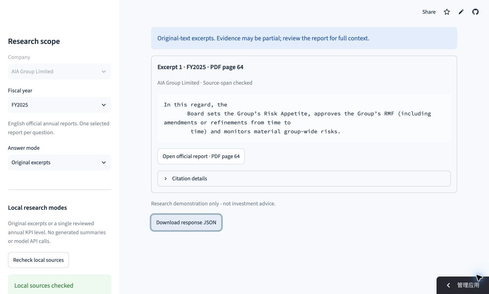
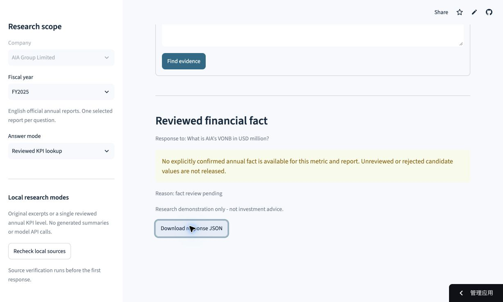

# Cloud repair: isolated session report loading

Executed on 2026-11-08 (Asia/Singapore) after the product owner supplied the
existing Streamlit app URL and its missing-page screenshot.

## Cause and implemented repair

The hosted checkout has source metadata, but correctly lacks ignored raw PDFs,
page snapshots and retrieval index. The prior interface consequently disabled
queries with a missing `data/processed/AIA-2024-EN.pages.json` error. Committing
full report data would violate the repository's publication scope.

The repair introduces an explicit, per-session loading workflow for exactly the
registered AIA FY2024/FY2025 English report versions. Both whole-file SHA256
values must match before parsing. The backend uses staged, private temporary
storage, prepares all page/index files, revalidates the retriever and existing
review decisions, and atomically adopts the complete directory. It never writes
raw data or caches into the source checkout. No automatic download or model API
is involved.

The UI uploads the selected files to the application server for processing,
holds the temporary workspace for that app session, and offers explicit clear.
Clearing or metadata invalidation removes only the session-owned workspace and
rotates upload controls; other sessions and local source data remain separate.
Missing runtime data now has actionable report selectors and official links,
with the original diagnostic preserved in an expander. Each upload is limited
to 16 MiB. Normal prepared local workspaces keep working without uploading.

This is a fixed-report workflow, not arbitrary PDF chat or a preloaded public
corpus. AIA source terms restrict public/commercial reuse; public accessibility
does not establish permission. Users must have an appropriate basis to process
their selected reports. See [cloud setup](cloud-setup.md) for source references,
data handling and limitations. Full reports/text are not offered for download,
committed to GitHub or sent to a model provider. An idle disconnect does not
establish instantaneous deletion, and temporary storage is not durable.

## Files

| Files | Change |
| --- | --- |
| `session_data.py` | Exact report/size/hash checks, metadata snapshots, staged parser/index validation, isolated publication and cleanup |
| `ui.py` | Session upload/adoption/reset controls, missing-data guidance and metadata invalidation |
| `tests/test_session_data.py` | 28 neutral-PDF backend cases, including provenance, paths, failure cleanup, races and isolation |
| `tests/test_ui.py` | Six new end-to-end neutral upload/session cases through the real preparation pipeline |
| `.streamlit/config.toml` | 16 MiB upload limit; static file serving remains disabled |
| `README.md`, `ARCHITECTURE.md`, `PRD.md`, `docs/cloud-setup.md` | Correct hosted setup, current checks and explicit storage/review boundaries |
| `docs/phase-13-report.md` | This repair record |

## Actual automated checks

```bash
.venv/bin/python -m pytest -q tests/test_session_data.py tests/test_ui.py tests/test_ui_state.py
.venv/bin/python -m pytest -q
.venv/bin/python -m ruff check .
.venv/bin/python -m ruff format --check .
.venv/bin/python -m pip check
git diff --check
```

Focused suite: **77 passed**, 5 existing PyMuPDF/SWIG deprecation warnings,
4.03 s. Full suite: **609 passed**, the same 5 warnings, **9.97 s**.
Ruff check passed and all **48 Python files** were formatted. Pip found no broken
requirements; it disabled its unavailable cache. Diff whitespace checks passed.
Tests use explicitly labeled neutral documents, never invented company results.

Checks cover missing/wrong/extra/oversized uploads, pinned hashes and physical
pages, complete query readiness, stale metadata, existing-destination protection,
concurrent destination preparation, independent sessions, cleanup and secret/raw
history exclusion. UI checks preserve an old valid session on failed replacement,
clear old answers after metadata changes and reset upload selections on clear.

## Actual source rehearsal

The real local report bytes were supplied to the same backend in a new temporary
directory outside the project. This did not copy existing page/index caches.
The workspace fingerprint, source-rebuilding retriever and both answer modes
were then exercised. Actual result:

| Check | Result |
| --- | --- |
| Registered reports loaded | 2 |
| Physical page records | 734 |
| Evidence chunks | 2,159 |
| Risk Appetite/RMF excerpt | Source-span-checked FY2025 physical PDF page 64 |
| Confirmed financial facts | 0 |
| VONB lookup | `fact_review_pending`, no financial value |
| Historical raw evaluation copied | No |
| Source/review/manifest/evaluation-case bytes | Unchanged |

FY2025 physical page 3 still has no native text; the known warning remains
visible and page numbering is retained. Temporary rehearsal files were cleaned.
The local evidence is recorded under ignored `data/processed/phase-13-real-rehearsal.json`.
This is source/engineering verification, not financial acceptance or semantic
accuracy. All actual KPI and pair approvals and human evaluation ratings remain
pending.

## Publication and hosted verification

This tested repair is published to the existing repository under the owner's
standing instruction. It updates the owner's existing hosted app rather than
creating a new account or hosting service. The live follow-up below completes
the previously blocked upload/query check. Each new visitor/session must load
its own authorized report copies; the app does not distribute a shared complete
corpus.

### Completed hosted follow-up

Actual browser observations were recorded on 2026-11-08, with the downloaded
responses checked by **10:21:12 UTC**. The functional app version was commit
`288343a3a1a0e3ec5fc87f2bc91791c46ab6cef9`.

The initial assisted upload was blocked by Chrome's extension file-URL
permission. The owner explicitly reported enabling that setting. A fresh browser
task then uploaded the two original registered files through the separate
FY2024/FY2025 controls and clicked **Load official reports**. No permission was
changed by the application, and no original report PDF was committed to GitHub.

| Live cloud observation | Actual result |
| --- | --- |
| Official reports uploaded and adopted | 2 |
| App-reported physical pages / chunks | 734 / 2,159 |
| Original-excerpt query | `Which body sets AIA's Risk Appetite and approves its Risk Management Framework?` |
| Downloaded factual response | `local_extractive`, `extractive_evidence`, selected `AIA-2025-EN` |
| Released physical source page | 64; official report link ends in `#page=64` |
| Response source identity | FY2025 PDF SHA256 matches the registered `18537f928c3bb4879c35566252f2f8420c6a3a237016af4706b081a77d126977` |
| Reviewed KPI query | `What is AIA's VONB in USD million?` |
| Downloaded KPI response | `abstained`, `fact_review_pending`, `financial_fact=null` |
| Candidate/review/manifest/evaluation-case input bytes | Unchanged |

Both actual response JSON downloads are retained under ignored
`data/processed/phase-13-cloud-fy2025.response.json` and
`data/processed/phase-13-cloud-kpi.response.json`. The observed outcomes and
resolved upload blocker are recorded in the ignored cloud verification and
publication receipts. No browser time was presented as an app latency benchmark.

The public captures show actual hosted behavior:





The follow-up changes only documentation and screenshots. The 609-test software
checkpoint above was not represented as a new test execution. The cloud checks
do not approve the factual answer's completeness, any financial value or pair,
gold answers, or semantic evaluation scores. The owner can turn off the temporary
extension file-URL permission after verification. Future new sessions still need
their own report loading.
