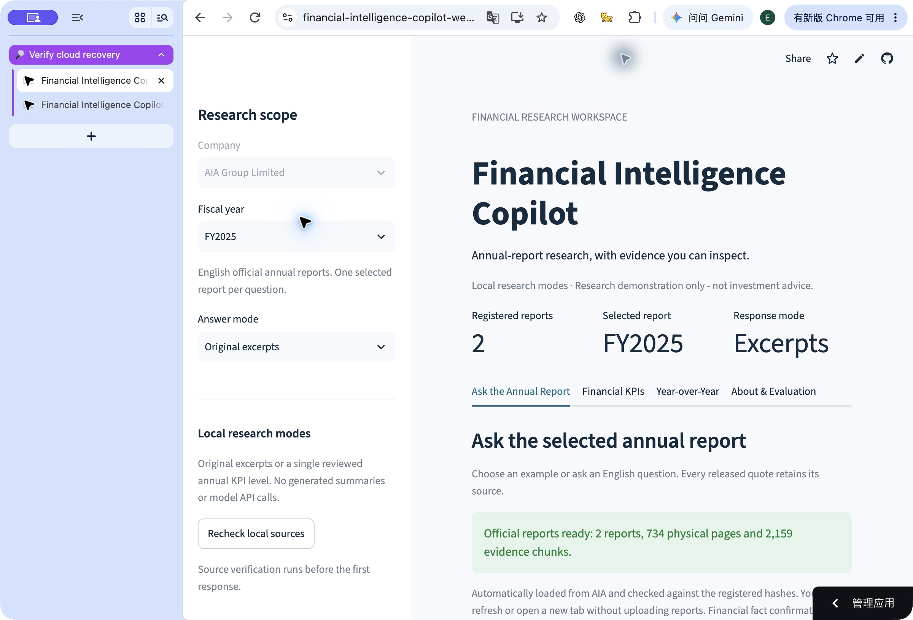
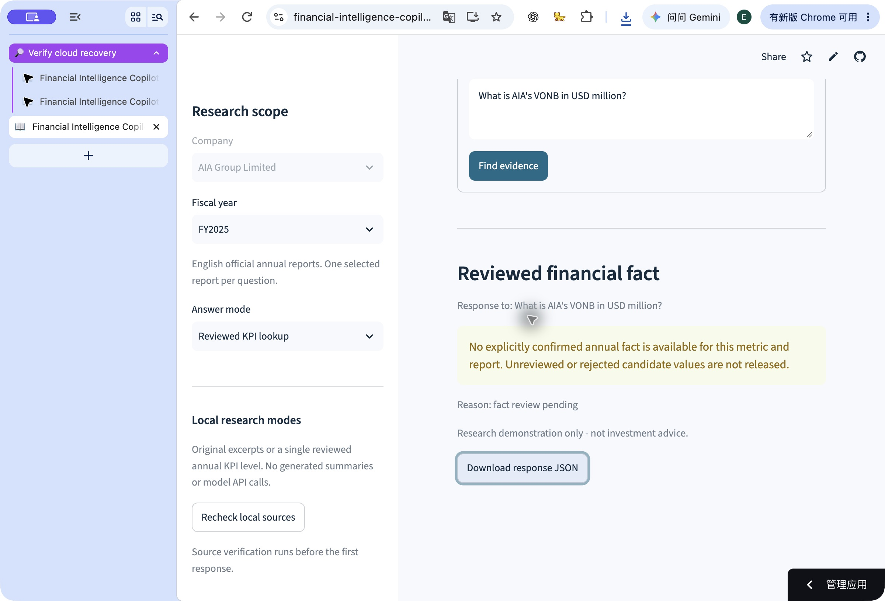

# Stage 14: public-link automatic official-report initialization

## Problem and product decision

Stage 13 successfully validated two real PDF uploads in one browser session.
The product owner's next tab still had no data because the temporary workspace
was owned by that WebSocket session. The earlier one-session success did not
prove that the public link was ready for a new visitor. Streamlit documents
this boundary in its [Session State reference](https://docs.streamlit.io/develop/api-reference/caching-and-state/st.session_state).

On 2026-11-08 the product owner selected automatic cloud initialization, so
visitors can ask questions without uploading reports. This changes the runtime
data lifecycle, not financial review or evaluation acceptance.

## Changed files and behavior

- `cloud_data.py` and `test_cloud_data.py`: exact official URL/hash/filename
  allowlist, bounded HTTPS transport, rejected redirects, complete staged
  preparation, actual download receipt and a locked process-owned runtime cache.
- `ui.py`, `app.py` and `test_ui.py`: automatic startup only for a completely
  empty runtime inventory, shared official data for fresh sessions, explicit
  retry, and isolated manual upload fallback. Partial local data is not hidden.
- `.env.example`, README, PRD, architecture and cloud setup: document automatic
  reconstruction after restart, the fallback's session boundary and actual
  acceptance limits. The process environment can disable automatic loading.

Original PDFs, page text, indexes, raw response JSON and local receipts remain
ignored. No API key, paid service, model call, new hosting target, browser
permission change or financial approval is introduced.

## Actual software and source checks

Commands run from the project root:

```sh
.venv/bin/python -m pytest -q
.venv/bin/python -m ruff check .
.venv/bin/python -m ruff format --check .
.venv/bin/python -m pip check
git diff --check
```

The implementation checkpoint passed **657 tests**, with five existing
PyMuPDF/SWIG deprecation warnings. Ruff lint/format, dependency consistency and
diff whitespace checks passed. The new backend's 43 transport/cache tests use
explicit neutral PDFs and fake transport responses; they do not fabricate AIA
financial results. The UI tests use real neutral PDF parsing/indexing with only
the network/cache boundary replaced.

The regression checks cover new independent sessions, both report years,
physical-page evidence, failure/retry without a widget-triggered request loop,
partial-local-data rejection, manual-upload isolation, pending financial facts,
concurrent cache reuse, source changes, oversized/incomplete/redirected
downloads, temporary cleanup and retained workspace ownership.

An actual-network local rehearsal completed at
**2026-11-08T10:46:54.479778+00:00**:

| Observation | Actual result |
| --- | --- |
| Official downloads | Exactly two; pinned hashes matched |
| Next cache access | Reused the same prepared root without another download |
| Prepared inventory | 2 reports, 734 physical pages, 2,159 chunks |
| Reviewed facts | 0 |
| FY2025 risk-governance query | `extractive_evidence`, first physical PDF page 64 |
| VONB lookup | `abstained`, `fact_review_pending`, no financial value |
| Manifest/candidates/reviews/evaluation cases | Byte hashes unchanged |

The original known FY2025 physical page 3 has no native extractable text. It
retains its physical page and empty-page status; OCR is still disabled. No
invented text replaces it. The ignored local rehearsal receipt is
`data/processed/phase-14-real-bootstrap.json`.

## Completed hosted acceptance

Completed on **2026-11-09 (Asia/Singapore)** against functional commit
`1c7908aff2887e8acfceacb8a4d2fa4626fa4819` on the existing
[public app](https://financial-intelligence-copilot-wenric.streamlit.app/).
The owner authorized the existing app's reboot. Its actual log records a fresh
startup at 2026-11-08 11:03:39 UTC and server startup at 11:03:59 UTC.

| Hosted check | Actual observation |
| --- | --- |
| Original public URL after reboot | Automatically ready: 2 reports / 734 physical pages / 2,159 chunks |
| PDF selections | None used during these checks |
| FY2025 risk-governance query | Original evidence at physical PDF page 64; downloaded response JSON checked |
| Source identity | SHA256 `18537f928c3bb4879c35566252f2f8420c6a3a237016af4706b081a77d126977` |
| Browser refresh | Returned to ready state without uploads; previous response cleared |
| Independent new tab | Ready with a fresh question state; actual query controls available |
| Unconfirmed VONB lookup | Downloaded JSON: `abstained`, `fact_review_pending`, `financial_fact: null` |
| Fresh incognito window | No login or upload required; actual governance query returned FY2025 physical page 64 |
| Incognito citation details | Same pinned hash, evidence ID `AIA-2025-EN:p64:88bbd948bd65d781f18d`, character range `[1151, 1344)` |
| Sharing setting | Observed as public and searchable; unchanged |
| Source/review/evaluation input files | Byte hashes still match the actual-network rehearsal baseline |

The factual question was: "Which body sets AIA's Risk Appetite and approves its
Risk Management Framework?" The financial boundary query was: "What is AIA's
VONB in USD million?" The normal-profile responses were downloaded through the
real app and retained locally as ignored JSON, not reconstructed from expected
answers. Incognito evidence was checked in the actual source card and expanded
citation details; no account sign-in was performed.

### Browser connection diagnosis

An additional problem affected the assisted check: the public Cloud wrapper
remained on its loading animation while the direct application route worked.
The browser's visible Network panel showed the iframe document request pending
in connection-start **Stalled**, with no response body transferred. Cancelling
the current Chrome debugging session through its browser infobar immediately
released that request and loaded the original public URL. Subsequent acceptance
used native screen/accessibility controls with the debugging connection closed.
The application and source configuration were unchanged during that comparison.

This observation applies to this assisted Chrome session. It is not evidence of
a general Streamlit outage, an AIA download failure or a latency benchmark. The
public root URL, not the diagnostic internal-frame route, passed the final
checks. No further upload or extension-file permission was needed.





Application text is English; browser and vendor controls retain their host
locale. The ignored local evidence record is
`data/processed/phase-14-hosted-verification.json`, with actual response exports
`phase-14-public-post-reboot.response.json` and
`phase-14-public-kpi-pending.response.json` in the same directory.

This hosted follow-up changes documentation and screenshots only. It retains
the recorded **657-test** result for the unchanged functional code; it does not
claim a new software test run, semantic evaluation or human judgment. Diff and
publication consistency checks are recorded separately.

## Remaining project gates

No gold answers, financial confirmations, pair-comparability decisions or human
scores were added. All ten real fact reviews and five comparisons remain
pending, with zero calculated pairs. The historical forty-case run is not
rerun or relabeled as this change's semantic accuracy. Automatic source loading
is an engineering repair, not completion of the financial MVP.
