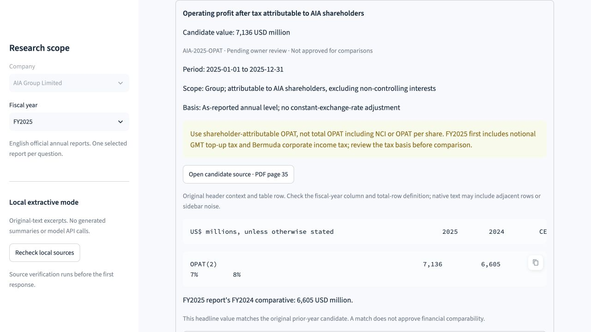

# Stage 6: source-backed KPI candidates and owner review

Publication note: machine-specific paths and interpreter commands are generalized
for sharing. Original execution transcripts are retained locally; placeholders
such as `<project-root>` and `<temporary-source-copy>` need local substitution.
Recorded commands, outcomes and limitations retain their original meaning.

Date: 2026-10-31 (Asia/Singapore).
Workspace: `<project-root>`.

## Outcome

Prepared five common AIA metrics for both FY2024 and FY2025: VONB, ANP, VONB
margin, shareholder-attributable OPAT, and UFSG. All ten records remain
**unverified and pending owner review**. The English Financial KPIs tab now
provides candidate inspection, exact source context, physical-page links,
definition/tax references and a pending-review CSV download.

Actual source checks found ten matching current-year numeric cells and five
matching FY2025 prior-year comparative cells. Zero records are verified. No
growth calculation or chart was produced. A match between five headline cells
does not establish unchanged definitions, absence of all restatements, or
financial comparability.

The [owner review guide](kpi-review-guide.md) contains candidate values, IDs,
physical pages, definitions and actionable review instructions. Local preview:
`http://127.0.0.1:8501`. No new dependency, model API call, deployment, Git commit
or push occurred in this stage.

## 1. Modified files

| File | Purpose |
| --- | --- |
| `data/kpi_candidates.json` | Ten actual source-backed records, all false/pending; separate FY2025 prior-year comparative cells |
| `src/financial_intelligence_copilot/financial_kpis.py` | Decimal parsing, whole-token/source validation, pending-only schema, review CSV export |
| `src/financial_intelligence_copilot/ui.py` | Candidate table/cards, explicit year-review scope, source/definition links and CSV download |
| `src/financial_intelligence_copilot/ui_state.py` | Include candidate-file bytes in workspace revision checks |
| `scripts/check_kpi_candidates.py` | Reproducible raw-PDF check and pending-review CSV export |
| `tests/test_financial_kpis.py` | 52 checks over neutral fixtures for Decimal, provenance, units, flags, malformed records and exports |
| `tests/test_ui.py` | Two additional AppTest workflows for pending-only candidate rendering and edited-value rejection |
| `docs/kpi-review-guide.md` | Financial review checklist, all candidate values/pages, basis caveats and decision format |
| `assets/screenshots/kpi-candidate-review.jpg` | Actual local browser capture of the OPAT review card |
| `README.md`, `docs/development-plan.md`, this report | Reproduction instructions, actual results and next acceptance gate |

Generated checks, test log and review CSVs are in the ignored `data/processed/`
directory. Raw reports, manifest acquisition details and full-page snapshots were
not replaced. The candidate JSON contains necessary short table context and
numeric facts, rather than either full annual report.

## 2. Actual source inspection and candidate selection

Used the already registered official English PDFs in `data/raw/`. No additional
report was downloaded. Rechecked SHA256 against the manifest and freshly
extracted native page text with PyMuPDF `get_text("text", sort=True)`.

Rendered the six primary CFO pages for visual table inspection:

```bash
pdftoppm -f 30 -l 30 -scale-to 1800 -png -singlefile \
  data/raw/AIA_2024_Annual_Report_EN.pdf /tmp/fic-kpi-candidate-review/2024-p30
pdftoppm -f 36 -l 36 -scale-to 1800 -png -singlefile \
  data/raw/AIA_2024_Annual_Report_EN.pdf /tmp/fic-kpi-candidate-review/2024-p36
pdftoppm -f 49 -l 49 -scale-to 1800 -png -singlefile \
  data/raw/AIA_2024_Annual_Report_EN.pdf /tmp/fic-kpi-candidate-review/2024-p49
pdftoppm -f 27 -l 27 -scale-to 1800 -png -singlefile \
  data/raw/AIA_2025_Annual_Report_EN.pdf /tmp/fic-kpi-candidate-review/2025-p27
pdftoppm -f 35 -l 35 -scale-to 1800 -png -singlefile \
  data/raw/AIA_2025_Annual_Report_EN.pdf /tmp/fic-kpi-candidate-review/2025-p35
pdftoppm -f 33 -l 33 -scale-to 1800 -png -singlefile \
  data/raw/AIA_2025_Annual_Report_EN.pdf /tmp/fic-kpi-candidate-review/2025-p33
```

The PNGs were opened for engineering review; they remain temporary local source
inspection material. Additional definition, annual-period, NCI, exchange-rate
and tax pages were read from the raw PDFs. A separate engineering audit repeated
the actual-byte/token checks and inspected OPAT/UFSG table renders. These are
engineering checks, not an owner signature.

Material interpretation issues are recorded in each candidate and the guide:

- VONB is Group Total after NCI; margin uses a gross-NCI definition excluding
  pension business. Dividing the selected VONB by ANP would misstate that margin.
- OPAT is attributable to shareholders, excluding NCI. Total OPAT including NCI
  is a different value and scope.
- UFSG is net of tax, before new-business reinvestment and central costs.
- Unadjusted annual reported levels are distinct from report CER/AER growth
  commentary. No narrative growth figure is used as a calculated result.
- FY2025 first includes notional GMT top-up tax in OPAT/UFSG and Bermuda income
  tax in OPAT. Future GMT assumptions for EV/VONB also require review. No tax
  adjustment or automatic comparability approval was made.

## 3. Loader and review safeguards

Values are plain decimal strings in JSON and exact `Decimal` objects in Python;
the loader never uses binary float arithmetic or scales units implicitly.
Percent values retain percent units. Dashes, malformed grouping, non-finite
tokens, mismatched percent symbols and duplicate percentage signs are rejected.

Each record binds to a manifest document, actual PDF hash, official source URL,
physical page, exact numeric token, containing row, header context and original
character offsets. Whole-token boundary checks prevent selecting only `605`
from `6,605`, or a suffix from a reported percentage. Wrong currency/unit,
duplicate metric-years, inconsistent report metadata, invalid reference pages
and missing reference topics fail validation.

The loader accepts only `verified=false`, `pending_owner_review`, no reviewer or
review date, and `needs_owner_review` comparability. It has no promotion method.
CSV export retains those flags and empty signatures, and escapes spreadsheet
formula prefixes in text fields. Financial-definition interpretation remains
manual even after all exact-span checks pass.

The UI hashes the candidate file along with the existing source inventory.
Changes clear cached candidates and old answers; a validation failure displays
an error rather than the prior candidate. Header context preserves original
text and may include adjacent rows or sidebar noise. It is displayed with
horizontal scrolling so source whitespace does not create large wrapped blocks.
The PDF is the reference for column layout.

## 4. Commands and actual automated results

```bash
.venv/bin/python -m pytest tests/test_financial_kpis.py -q
.venv/bin/python -m pytest tests/test_ui.py -q
.venv/bin/python -m pytest -q > data/processed/phase-6-pytest.log 2>&1
.venv/bin/python -m ruff check .
.venv/bin/python -m ruff format --check .
.venv/bin/python scripts/check_kpi_candidates.py \
  --output data/processed/phase-6-kpi-source-check.final.json \
  --csv data/processed/kpi-candidates-pending-review.final.csv
```

Actual final full-suite and source-check results:

```text
172 passed, 5 warnings in 2.58s
All checks passed!
23 files already formatted
Source-checked 10 candidates; 0 verified. Owner review pending.
Prior comparative matches: 5/5; no YoY calculated.
```

The final KPI-focused run passed 52 tests; the UI-focused run passed eight. Five
warnings are the existing PyMuPDF/SWIG import deprecations. The first run of the
two new UI tests failed because the fixture helper assumed a final newline in
normalized page text. Using the actual end of text corrected the helper; the
production source records were not changed to make those tests pass. Review
also found and fixed partial-number acceptance and malformed-definition-reference
handling, with dedicated regressions.

Unit tests use explicitly neutral generated documents, not fabricated AIA
financial evidence. Schema-routing metric/company labels are explained in the
fixtures. The real-report source-check command is separate from those tests.
The counts above are software/provenance checks, not financial correctness,
answer accuracy, product acceptance, or the planned 40-question evaluation.

The initial source-check outputs remain available as an earlier run. Re-running
the script requires new output filenames; it refuses existing output files.

## 5. Live local browser checks

Restarted the existing loopback-only preview with:

```bash
.venv/bin/python -m streamlit run app.py \
  --server.address 127.0.0.1 --server.port 8501 \
  --server.headless true --browser.gatherUsageStats false
```

Observed in the real browser:

| Action | Observed result |
| --- | --- |
| Open Financial KPIs / FY2025 | Five candidates, pending warning, verified-KPI status still unavailable |
| Choose Both fiscal years | Ten separately year-labeled candidates and selector options |
| Select FY2025 VONB_MARGIN | 58.5 percent, no currency, gross-NCI/pension caveat, PDF page 27 |
| Select FY2025 OPAT | 7,136 USD million, shareholder scope, tax warning, PDF page 35 and original row |
| Download all-candidate CSV | Actual local download; inspection found ten false/pending rows and no reviewer/date signatures |
| Open Year-over-Year | Unavailable pending verified comparable inputs; no growth rates/charts |
| Switch to FY2024 / selected-year mode | Five FY2024 rows; ANP card 8,606 USD million with PDF page 30 |

Manual observations are recorded in ignored
`data/processed/phase-6-browser-checks.json`. The browser download is
`<downloads-directory>/kpi-candidates-pending-review.csv`; the final script
export in `data/processed/` also includes the subsequently expanded scope notes.
The screenshot below is an actual capture, not a mockup or owner approval.



## 6. Remaining acceptance work

The owner must review the candidate facts and separately decide comparability,
using the guide and official PDFs. Explicit decisions should identify candidate
IDs, confirmed fields, corrections, reviewer/date and any unresolved basis
issues. Generic requests to continue development do not verify financial facts.

Only after that gate should a separate reviewed store be created and consumed by
tested Python comparison rules. Those rules must distinguish amounts, percent
changes and percentage points, reject zero/negative or incompatible bases, and
preserve independent evidence for each input. Ask the Annual Report continues
to abstain on verified-KPI and comparison requests. LLM integration and the
40-question owner-reviewed evaluation remain pending.
